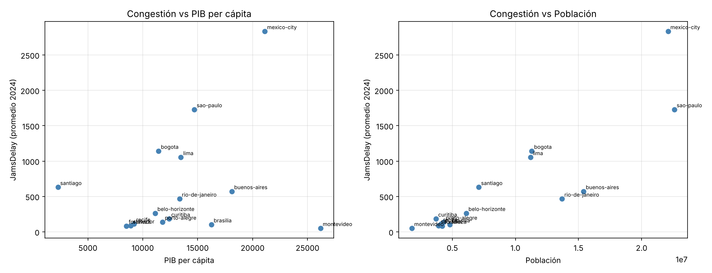

# 🚦 Movilidad urbana y desarrollo económico — Ciudades de América Latina

**TripleTen Data Analyst Bootcamp · Proyecto 5 · 2026**

¿Se relaciona el desarrollo económico de una ciudad latinoamericana con su nivel de congestión? Se integraron dos fuentes heterogéneas, **TomTom Traffic Index** (tráfico) y **OECD City Economy** (economía), para **15 ciudades de América Latina en 2024**.

---

## 📋 Hallazgos principales

Congestión medida con `JamsDelay` (retraso acumulado por congestión, promedio 2024), n = 15 ciudades:

| Variable | Pearson r | p-valor | Lectura |
|---|---|---|---|
| PIB per cápita | 0.28 | 0.31 | Relación débil, no significativa |
| Población | 0.88 | < 0.001 | Asociación fuerte |
| PM2.5 | 0.77 | 0.001 | Asociación fuerte (se mueve con el tamaño de la ciudad) |
| Desempleo (%) | −0.69 | 0.005 | Asociación negativa (se mueve con el tamaño de la ciudad) |

- Las ciudades más ricas **no** son necesariamente las más congestionadas; el **tamaño de la ciudad** es lo que más se asocia con la congestión.
- Ciudad de México (≈ 2,833) y São Paulo (≈ 1,729) lideran la región.
- Con 15 ciudades no es posible separar el efecto de población, contaminación y desempleo entre sí.



### Calidad de datos y correcciones

- **Cruce duplicado:** el dataset económico trae 2023 y 2024; unirlo sin filtrar el año duplicaba cada ciudad (30 filas en lugar de 15). Se filtró 2024.
- **Posible error de captura en la fuente:** el PIB per cápita de Santiago en 2024 es 2,277 frente a 22,176 en 2023 (y Fortaleza 2023 = 838). No se corrigió; sin Santiago la conclusión no cambia (r = 0.34, p = 0.24).
- **Formatos:** fechas como texto y números con punto de miles, coma decimal o `%` se convirtieron a tipos numéricos.

### Limitaciones

Muestra pequeña, correlación no implica causalidad y el tráfico se resumió en un promedio anual (no distingue horas ni días).

---

## 🗂️ Estructura del repositorio

```
Movilidad-LATAM/
├── notebooks/
│   └── 01_analisis_movilidad_latam.ipynb   # Análisis completo (limpieza, cruce, correlaciones)
├── src/
│   └── pipeline_limpieza.py                # Pipeline que reproduce el dataset final
├── data/
│   ├── ladb_mobility_economy_2024_clean.csv  # Dataset final (15 ciudades)
│   └── README.md                           # Cómo obtener los datos originales
├── outputs/
│   └── congestion_vs_pib_poblacion.png
├── requirements.txt
├── .gitignore
└── README.md
```

---

## 🔧 Cómo reproducirlo

```bash
git clone https://github.com/lgbarrerab-cpu/Movilidad-LATAM.git
cd Movilidad-LATAM
pip install -r requirements.txt

# Coloca tomtom_traffic.csv y oecd_city_economy.csv en datasets/ y ejecuta:
python src/pipeline_limpieza.py datasets/tomtom_traffic.csv datasets/oecd_city_economy.csv data/ladb_mobility_economy_2024_clean.csv
jupyter notebook notebooks/01_analisis_movilidad_latam.ipynb
```

Los datos originales (`tomtom_traffic.csv`, ~150 MB) fueron provistos por el bootcamp y no se incluyen en el repositorio.

---

## 📊 Stack

Python · pandas · NumPy · SciPy · matplotlib · seaborn · Jupyter

---

## 👤 Autor

**Luis Guillermo Barrera Barrios** · Data Analyst | Ingeniero Civil  
📧 Lgbarrerab@gmail.com · 🔗 [LinkedIn](https://www.linkedin.com/in/luis-guillermo-barrera-barrios-64aa5790) · [Portafolio](https://lgbarrerab-cpu.github.io)
